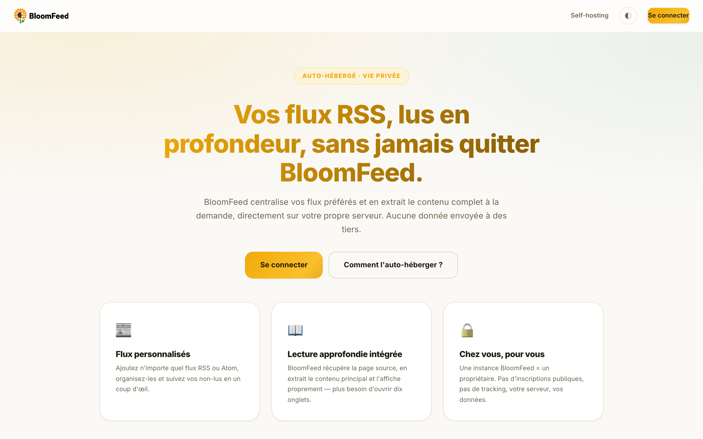
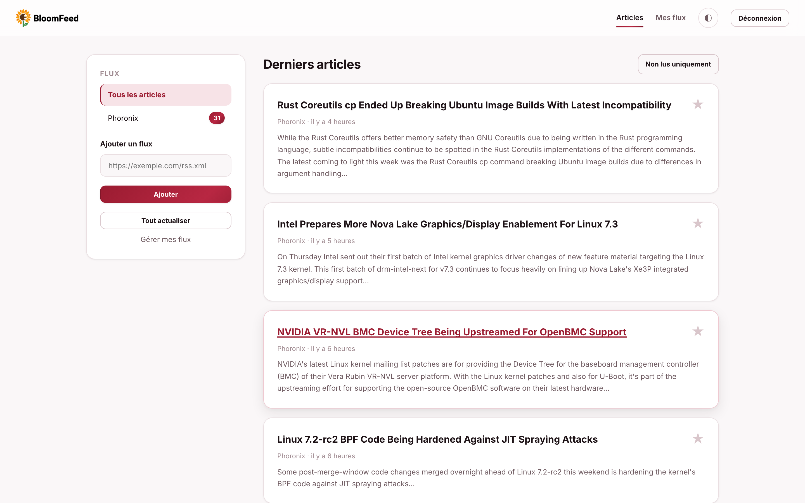
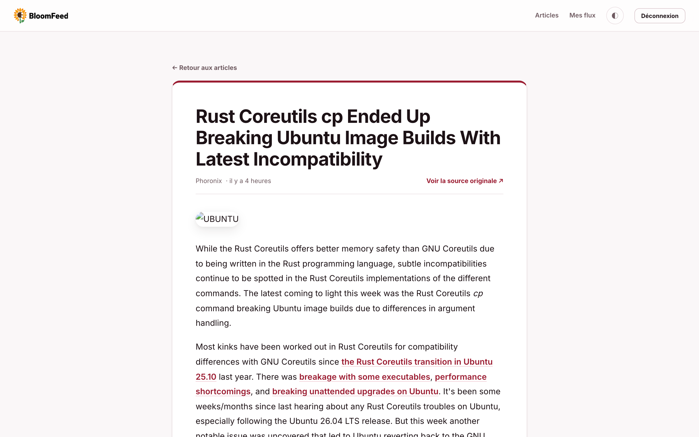
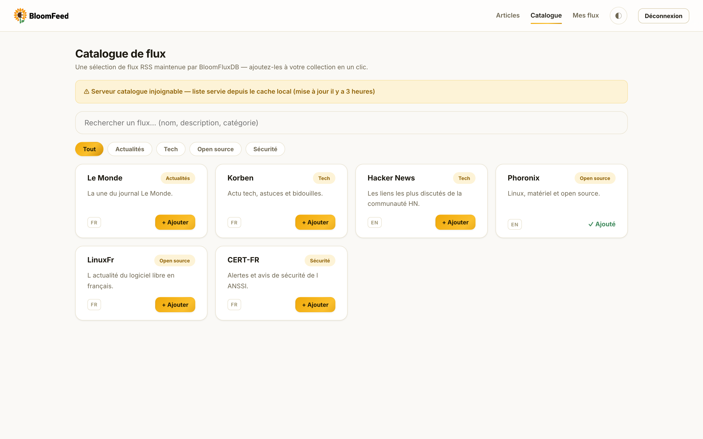
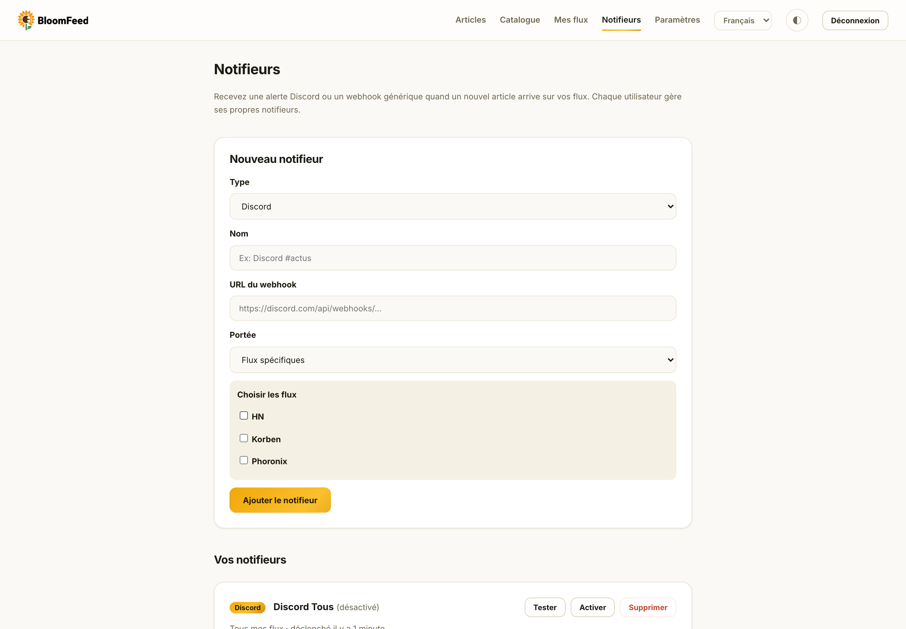
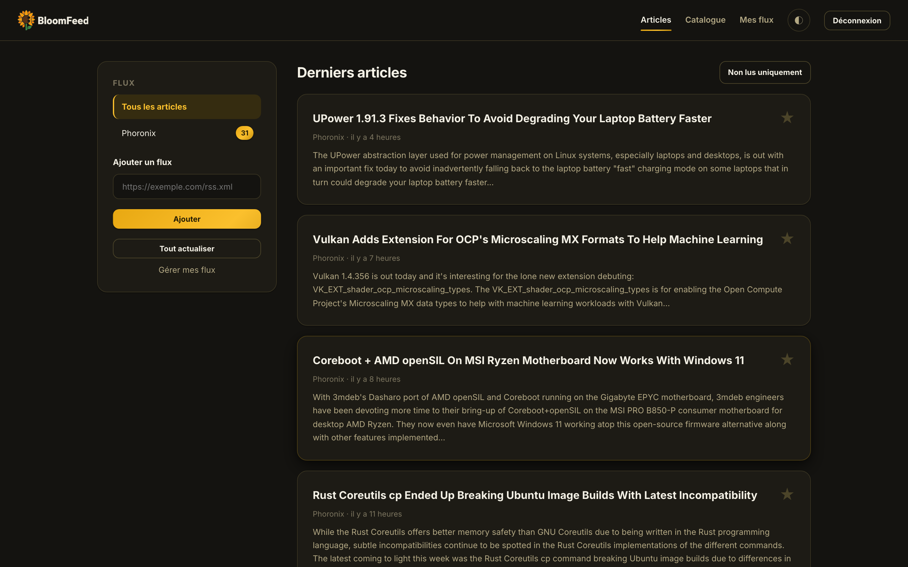

<p align="center"></p>

<p align="center">
Un agrégateur RSS personnel et auto-hébergé, avec lecture approfondie intégrée.<br>
<em>A personal, self-hosted RSS aggregator with a built-in reader.</em>
</p>

<p align="center"></p>

## Qu'est-ce que BloomFeed ?

BloomFeed centralise vos flux RSS/Atom préférés dans une interface simple. Quand un article vous
intéresse, BloomFeed récupère la page source, en extrait le contenu principal et l'affiche
directement dans l'application — plus besoin d'ouvrir le site d'origine.

BloomFeed est pensé pour être **auto-hébergé par une personne ou un foyer** : le premier compte
créé devient le compte propriétaire, qui peut ensuite inviter des proches (création directe de
comptes) ou ouvrir les inscriptions publiques depuis le menu Paramètres.

## Fonctionnalités

- Ajout de flux RSS/Atom, suivi des non-lus, favoris.
- Lecture approfondie intégrée : extraction du contenu principal (via
  [Readability](https://github.com/fivefilters/readability.php)) converti en Markdown, sans
  quitter BloomFeed.
- Catalogue de flux façon "market" : une sélection de flux embarquée avec l'application
  ([resources/data/bloomflux.json](resources/data/bloomflux.json)), à ajouter en un clic.
- Multi-comptes : le propriétaire crée des comptes ou ouvre/ferme les inscriptions d'un clic.
- Notifications personnelles : chaque utilisateur configure ses propres alertes **Discord** ou
  **webhook générique**, pour tous ses flux ou seulement certains.
- Interface disponible en **français, anglais, espagnol et allemand** (sélecteur en haut de page,
  préférence mémorisée par utilisateur).
- Récupération périodique des flux via une tâche planifiée.
- Thème clair/sombre.

## Aperçu

| Tableau de bord | Lecteur intégré |
|---|---|
|  |  |

| Catalogue de flux | Notifieurs |
|---|---|
|  |  |

| Mode sombre |
|---|
|  |

## Stack technique

- [Laravel 13](https://laravel.com) (PHP 8.4)
- MariaDB
- CSS/JS écrits à la main, sans étape de build (pas de Node/Vite/Tailwind)
- Docker Compose pour le déploiement

## Installation (auto-hébergement)

### Prérequis

- Un serveur Linux avec **Docker** et le plugin **Docker Compose**.
- Le port **7081** libre (modifiable dans `docker-compose.yml`).
- Optionnel : un nom de domaine + reverse proxy (Nginx, Caddy, Traefik…) pour le HTTPS —
  l'application détecte automatiquement les en-têtes `X-Forwarded-*`.

### Étapes

```bash
git clone https://git.eldorianet.work/esteban/BloomFeed-RSS bloomfeed
cd bloomfeed
bash scriptsite.sh
```

Le script de déploiement :

1. libère le port 7081 si nécessaire ;
2. clone ou met à jour le code dans `/opt/bloomfeed` ;
3. crée le `.env` depuis `.env.example` s'il n'existe pas, et y génère les secrets manquants
   (`APP_KEY`, `DB_PASSWORD`, `DB_ROOT_PASSWORD`) — ils ne sont **jamais** régénérés ensuite ;
4. construit les images et démarre les conteneurs (application, planificateur, MariaDB) ;
5. attend que les migrations de l'entrypoint soient terminées et vérifie que l'application répond.

Ouvrez ensuite `http://votre-serveur:7081` et créez le **compte propriétaire** — les inscriptions
publiques se referment automatiquement après.

### Mise à jour

Relancez simplement `bash scriptsite.sh` : il récupère les derniers changements et reconstruit
la stack sans toucher à vos données.

Avant chaque redéploiement (s'il existe déjà une instance en cours), le script sauvegarde
automatiquement la base de données dans `backups/bloomfeed-<date>.sql.gz` (les 10 dernières
sauvegardes sont conservées). Si la sauvegarde échoue, la mise à jour est annulée pour ne
jamais risquer de perdre des données. Pour restaurer une sauvegarde :

```bash
gunzip -c backups/bloomfeed-20260706-120000.sql.gz \
  | sudo docker compose exec -T db sh -c 'exec mariadb -u root -p"$MARIADB_ROOT_PASSWORD"'
```

### Mise à jour automatique

`auto-update.sh` vérifie périodiquement si le dépôt a de nouveaux commits sur `origin/main` et
ne redéploie (via `scriptsite.sh`) que si c'est le cas — une instance à jour ne reconstruit jamais
pour rien. Le mécanisme tourne sur l'hôte via une tâche cron dédiée (`/etc/cron.d/bloomfeed-auto-update`),
jamais depuis le conteneur applicatif (qui n'a pas accès au démon Docker, par sécurité).

```bash
bash auto-update.sh --install        # active la vérification toutes les 30 min (défaut)
bash auto-update.sh --install 60     # ou toutes les 60 min
bash auto-update.sh --status         # état actuel + derniers logs
bash auto-update.sh --force          # force un redéploiement immédiat
bash auto-update.sh --uninstall      # désactive la mise à jour automatique
```

Les logs sont écrits dans `storage/logs/auto-update.log` à l'intérieur du dépôt.

### Réinitialisation

Pour repartir d'une instance vierge (efface comptes, flux, articles et notifieurs) sans toucher
au code, au `.env` ni aux images Docker :

```bash
bash reset.sh          # confirmation interactive requise
bash reset.sh --yes    # sans confirmation
```

### Désinstallation

```bash
bash uninstall.sh              # arrête et supprime les conteneurs (données conservées)
bash uninstall.sh --purge      # supprime aussi la base de données et le storage (confirmation demandée)
bash uninstall.sh --purge --purge-source   # supprime aussi /opt/bloomfeed et le .env
```

## Configuration

### Comptes et inscriptions

Le compte propriétaire dispose d'un menu **Paramètres** dans la barre de navigation :

- **Créer un compte** directement (nom, e-mail, mot de passe) pour un proche, sans rien ouvrir
  au public ;
- **Ouvrir / fermer les inscriptions publiques** d'un clic — quand elles sont ouvertes, le bouton
  "Créer un compte" réapparaît sur la page d'accueil et la page de connexion.

### Langue

Chaque visiteur ou utilisateur choisit sa langue (FR, EN, ES, DE) via le sélecteur en haut de
page. Le choix est mémorisé en session pour les visiteurs et enregistré sur le profil pour les
utilisateurs connectés. La langue par défaut de l'instance se règle avec `APP_LOCALE` dans `.env`.

### Variables d'environnement principales

| Variable | Rôle | Défaut |
|---|---|---|
| `APP_URL` | URL publique de l'instance (importante derrière un reverse proxy HTTPS) | `http://localhost:7081` |
| `APP_LOCALE` | Langue par défaut (`fr`, `en`, `es`, `de`) | `fr` |
| `DB_*` | Connexion MariaDB (générés par le script) | — |

### Catalogue de flux

L'onglet **Catalogue** propose une sélection de flux pré-faits (actualités, tech, développement,
IT/sysadmin, sécurité, sciences…) à ajouter en un clic. La liste vit dans
[resources/data/bloomflux.json](resources/data/bloomflux.json), versionnée avec le code : pour
l'enrichir, éditez le fichier et redéployez — aucun service externe n'est nécessaire.

```json
{ "title": "Nom du flux", "url": "https://exemple.com/rss.xml", "category": "Tech", "lang": "fr", "description": "Courte description." }
```

### Notifications (Discord / webhook)

Chaque utilisateur configure ses propres notifieurs depuis le menu **Notifieurs** :

- **Discord** : collez l'URL d'un webhook de salon Discord (Paramètres du salon → Intégrations →
  Webhooks) ; BloomFeed envoie un embed (titre, lien, extrait) à chaque nouvel article.
- **Webhook générique** : n'importe quelle URL recevant un `POST` JSON
  `{ "event": "article.created", "feed": "...", "article": { "title", "url", "excerpt", "published_at" } }`.

Chaque notifieur a une **portée** : tous les flux de l'utilisateur, ou une sélection précise de
flux. Un bouton "Tester" envoie une notification factice pour valider l'URL avant de compter dessus.

## Développement local

Prérequis : PHP 8.3+ et [Composer](https://getcomposer.org).

```bash
composer install
cp .env.example .env
# Passer DB_CONNECTION=sqlite dans .env pour un dev local sans MariaDB
touch database/database.sqlite
php artisan key:generate
php artisan migrate
php artisan serve
```

## Licence

[MIT](LICENSE).
