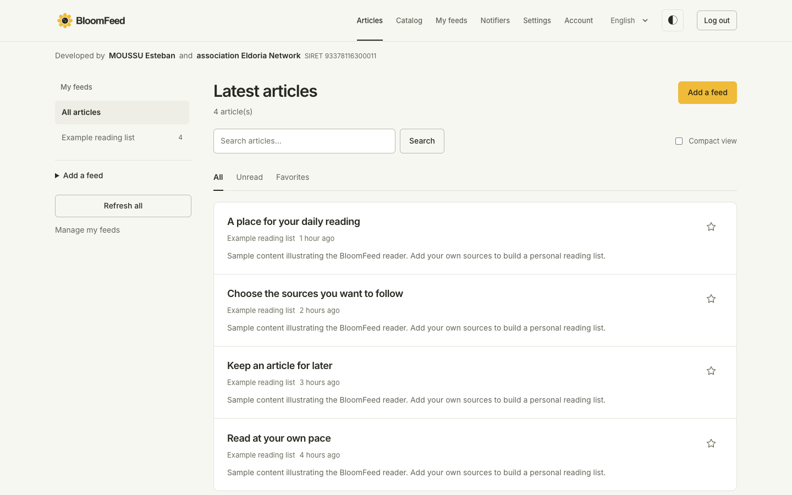
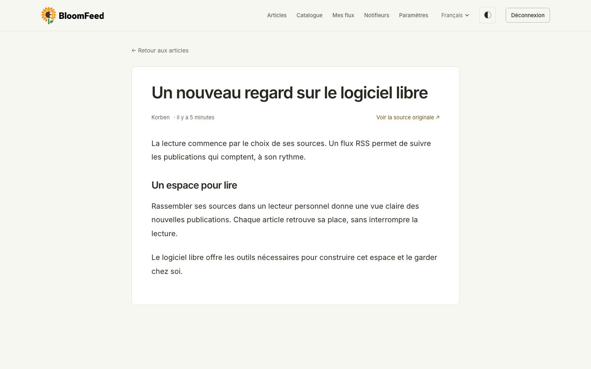
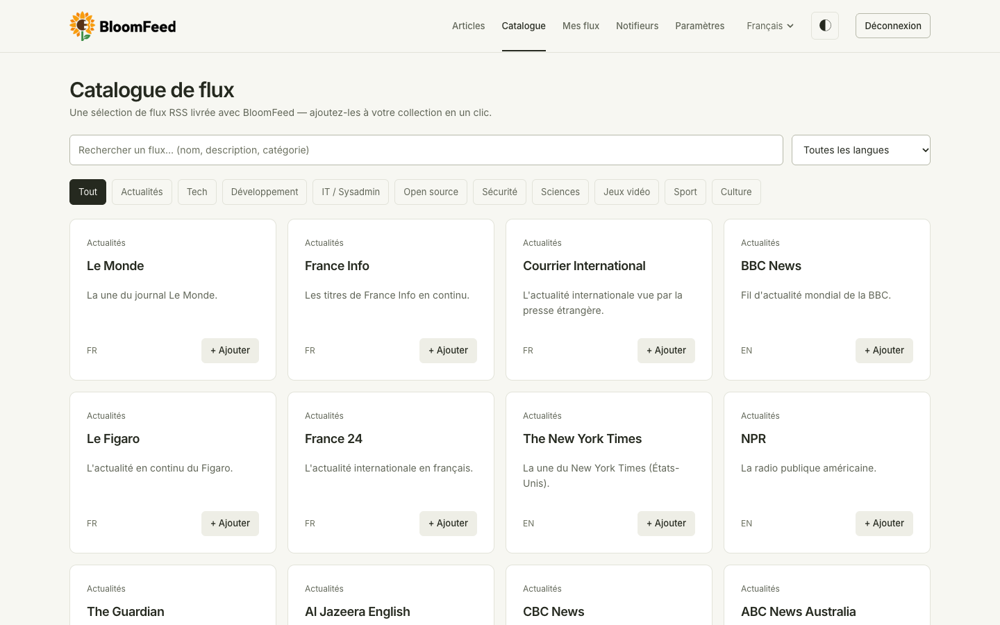
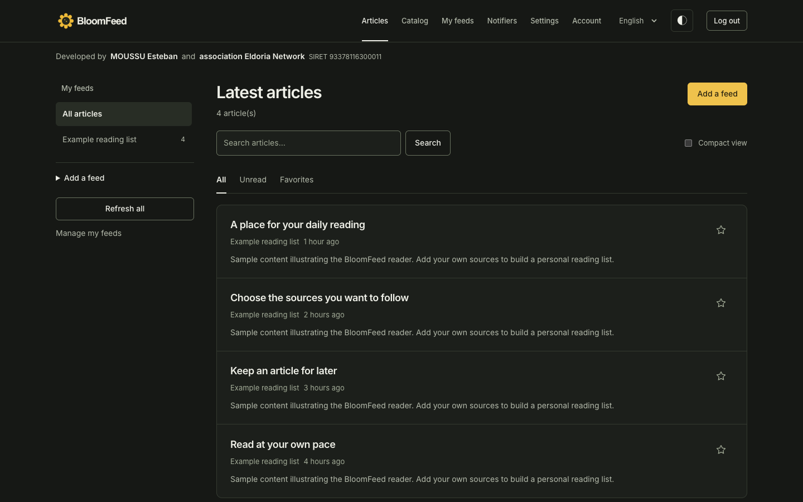
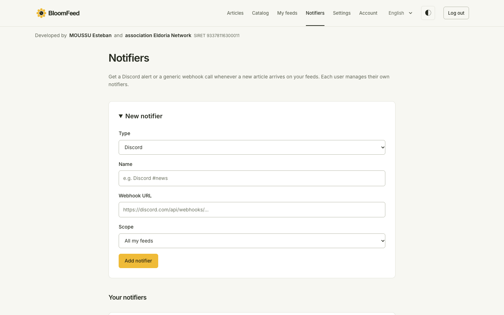

<p align="center"></p>

<p align="center">A personal, self-hosted RSS reader.<br>Developed by <strong>MOUSSU Esteban</strong> and the association <strong>Eldoria Network</strong>.<br>SIRET: 93378116300011</p>

<p align="center"></p>

## About

BloomFeed brings your RSS and Atom feeds together in one place. Open an article to fetch its source page and read the full text inside the app. Search by title or source, filter unread articles, and save favorites for later.

The first account becomes the instance owner. The owner can create accounts for other people or open public registration. Each account has its own feeds, reading history, favorites, and notifications.

## Project topics

RSS reader, Atom feeds, RSS aggregator, self-hosted feed reader, read-it-later, feed catalog, personal reading, Laravel, PHP, Docker Compose, Discord webhooks, privacy, Eldoria Network.

BloomFeed is developed by MOUSSU Esteban and the association Eldoria Network (SIRET 93378116300011). Personal non-commercial self-hosting is permitted under the project license.

## Features

- RSS and Atom subscriptions with scheduled refreshes and unread counts.
- Full-article reading using [Readability](https://github.com/fivefilters/readability.php), with content converted to Markdown.
- Article search, unread and favorite filters, and a saved compact-view preference.
- A built-in [feed catalog](resources/data/bloomflux.json), with search, category and language filters.
- Discord and generic webhook notifications for all feeds or a selected set.
- Owner controls for accounts, registration, and additional catalog sources.
- English by default, with French, Spanish, and German available from the language selector.
- Light and dark themes, keyboard navigation, and collapsible navigation on mobile.

## Screenshots

| Reader | Feed catalog |
| --- | --- |
|  |  |

| Dark theme | Notifications |
| --- | --- |
|  |  |

Screenshots use a local demo account with sample articles.

## Stack

- Laravel 13, with PHP 8.4 in Docker
- MariaDB
- Handwritten CSS and JavaScript, with no frontend build step
- Docker Compose

## Self-hosting

### Requirements

- A Linux server with Docker and the Docker Compose plugin.
- Port **7081** available. Change the port mapping in `docker-compose.yml` if needed.
- For HTTPS, a domain name and reverse proxy such as Nginx, Caddy, or Traefik. The app supports `X-Forwarded-*` headers.

### Install

```bash
git clone https://git.eldorianet.work/esteban/BloomFeed-RSS bloomfeed
cd bloomfeed
bash scriptsite.sh
```

The deployment script:

1. Checks that Docker Compose and the Docker daemon are available.
2. Clones or updates the repository in `/opt/bloomfeed`.
3. Creates `.env` from `.env.example` when missing and generates missing secrets: `APP_KEY`, `DB_PASSWORD`, and `DB_ROOT_PASSWORD`. Existing secrets are preserved.
4. Builds the images and starts the application, scheduler, and MariaDB containers.
5. Waits for the entrypoint migrations and checks that the application responds.

Open `http://your-server:7081` and create the owner account. Public registration closes automatically after the first account is created.

### Update and backups

Run `bash scriptsite.sh` again to fetch the latest changes and rebuild the containers.

Before updating a running instance, the script backs up the database to `backups/bloomfeed-<date>.sql.gz`. It keeps the ten most recent backups. If the backup fails, the update stops.

To restore a backup, run this from `/opt/bloomfeed`:

```bash
gunzip -c backups/bloomfeed-20260706-120000.sql.gz \
  | sudo docker compose exec -T db sh -c 'exec mariadb -u root -p"$MARIADB_ROOT_PASSWORD"'
```

### Automatic updates

`auto-update.sh` checks `origin/main` and redeploys only when new commits are available. It runs on the host through `/etc/cron.d/bloomfeed-auto-update`; the application container does not need access to Docker.

```bash
bash auto-update.sh --install        # Check every 30 minutes
bash auto-update.sh --install 60     # Check every 60 minutes
bash auto-update.sh --status         # Show status and recent logs
bash auto-update.sh --force          # Redeploy immediately
bash auto-update.sh --uninstall      # Disable automatic updates
```

Logs are written to `storage/logs/auto-update.log` inside the repository.

### Reset

A reset deletes accounts, feeds, articles, and notifications. It leaves the source code, `.env`, and Docker images in place.

```bash
bash reset.sh          # Ask for confirmation
bash reset.sh --yes    # Reset without prompting
```

### Uninstall

```bash
bash uninstall.sh                         # Remove containers, keep data
bash uninstall.sh --purge                 # Also delete database and storage; asks for confirmation
bash uninstall.sh --purge --purge-source  # Also delete /opt/bloomfeed and .env
```

## Security and network configuration

Outbound feeds, article pages, catalog sources, and webhooks are restricted to public HTTP/HTTPS destinations on ports 80 and 443. Private, loopback, link-local, reserved addresses, embedded credentials, and webhook redirects are blocked. DNS hostnames use IPv4 and the checked address is pinned for the connection; public IPv6 literals are supported. Responses are limited to 5 MiB and must use identity encoding. Each feed processes at most 100 entries per refresh.

Accounts can subscribe to 100 feeds and create 10 notification destinations. Changes to these limits are maintained in `config/security.php`. Login and expensive actions are rate-limited.

Set `TRUSTED_PROXIES` to the exact IP addresses or CIDRs of your reverse proxies. It is empty by default; arbitrary forwarded IPs are ignored. Never use `*`. Optionally set `TRUSTED_HOSTS` to a comma-separated list of accepted public hostnames. Keep `APP_URL` set to the public HTTPS URL so session cookies use Secure. Restrict direct origin access with your firewall.

Password changes invalidate previous browser sessions and remember-me tokens. Existing sessions from before the update are also rejected after the account password changes.

Feed additions and manual refreshes run through the queue worker included in Docker Compose. Outside Docker, run `php artisan queue:work --tries=1 --timeout=90`; use `QUEUE_CONNECTION=database` and `DB_QUEUE_RETRY_AFTER=120`. Do not use the synchronous queue driver in production. The worker also delivers new-article notifications. After updating, deploy migrations and restart all application and worker containers.

Docker builds reject PHP versions older than 8.4.27 and disable session upload progress. Rebuild with `--pull` to receive current base-image updates. These measures complement dependency audits; the operating system and Docker host still require regular updates.

## Configuration

### Accounts

The owner can use **Settings** to create accounts directly or enable public registration. When registration is enabled, the home and login pages offer a **Create account** link.

### Password

Open **Account** in the navigation to change your password. Enter your current password and confirm the new one.

### Language

English is the default. Visitors can choose another language using the selector at the top of the page. The choice is stored in the session and, for signed-in users, in their profile.

Set `APP_LOCALE` in `.env` to change the instance default. Existing language preferences take precedence. If an existing installation uses `APP_LOCALE=fr`, change it to `APP_LOCALE=en` and redeploy to use English for visitors without a saved preference.

| Variable | Purpose | Default |
| --- | --- | --- |
| `APP_URL` | Public instance URL, including the HTTPS scheme when using a reverse proxy | `http://localhost:7081` |
| `APP_LOCALE` | Default language: `en`, `fr`, `es`, or `de` | `en` |
| `APP_FALLBACK_LOCALE` | Language used when a translation is missing | `en` |
| `DB_*` | MariaDB connection settings | See `.env.example`; passwords are generated during deployment |

### Feed catalog

The catalog includes feeds covering news, technology, development, system administration, security, science, and other topics. Edit [resources/data/bloomflux.json](resources/data/bloomflux.json) and redeploy to update the built-in list.

```json
{
  "title": "Example feed",
  "url": "https://example.com/rss.xml",
  "category": "Tech",
  "lang": "en",
  "description": "News and technical articles."
}
```

The owner can also add external catalog sources in Settings. Each source must provide a JSON file containing a `feeds` array.

### Notifications

Each account configures its own notifications:

- **Discord:** paste a channel webhook URL from Channel Settings, Integrations, Webhooks. BloomFeed sends the article title, link, and excerpt.
- **Generic webhook:** provide an endpoint that accepts a JSON `POST` with this structure:

```json
{
  "event": "article.created",
  "feed": "Example feed",
  "article": {
    "title": "Article title",
    "url": "https://example.com/article",
    "excerpt": "Article excerpt.",
    "published_at": "2026-10-30T12:00:00+00:00"
  }
}
```

Choose all feeds or select specific subscriptions. Use **Send test** to check the destination.

## Local development

Install PHP and [Composer](https://getcomposer.org). PHP 8.4 or newer is recommended for the locked development dependencies.

```bash
composer install
cp .env.example .env
```

For local SQLite development, set these values in `.env`. Remove the `DB_DATABASE` line from `.env` to use Laravel's default SQLite file:

```dotenv
APP_ENV=local
APP_DEBUG=true
APP_URL=http://localhost:8000
DB_CONNECTION=sqlite
```

Then run:

```bash
touch database/database.sqlite
php artisan key:generate
php artisan migrate
php artisan serve
```

Run the tests with:

```bash
php artisan test
```

## Contributing

See [CONTRIBUTING.md](CONTRIBUTING.md) for development and pull request guidelines, and [SECURITY.md](SECURITY.md) for vulnerability reports.

## License

Copyright (c) 2026 MOUSSU Esteban. New versions use the [BloomFeed Personal Use License](LICENSE).

Personal, non-commercial self-hosting and private modifications are permitted. Redistribution, resale, and hosted services require written permission. This is not an open-source license. Earlier MIT releases retain their original permissions; see [the legacy notice](licenses/MIT-legacy.txt).

Third-party dependencies retain their own licenses, available through `composer licenses` after installation.
